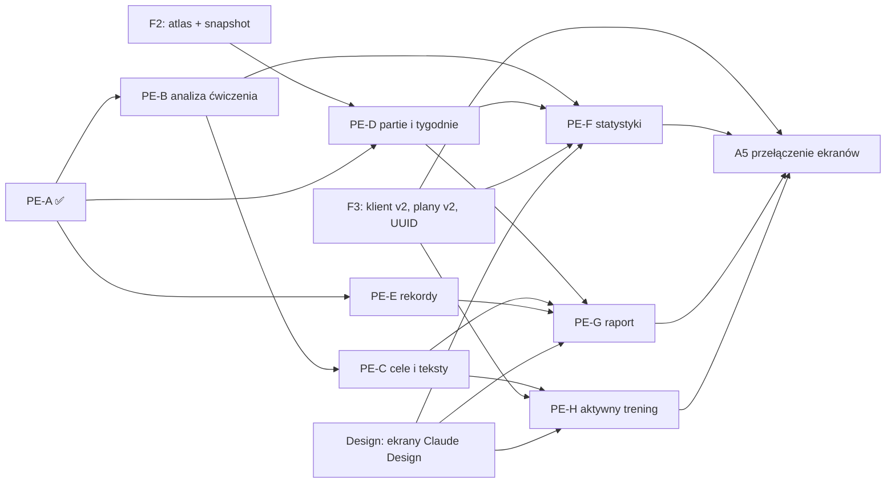

# NEXTREP Reporting Engine — mapa zakresu i zależności od etapów Progress Engine

Wersja 1 · 11.10.2026 · gałąź `release/1.0` · status: **do akceptacji** (dokumentacja)

## 0. Zakres i zasady tej mapy

Decyzja F-3 (11.10.2026): Reporting Engine jest szerszy niż PE-F i PE-G. Obejmuje zatwierdzony zakres
analityki PRO: **progresję, regresję, objętość, rekordy, trendy, stagnację, realizację planu i
rekomendacje**.

Źródła definicji: „Progress Engine 2.0: audyt i specyfikacja” (decyzje D1–D14 zatwierdzone 10.10.2026,
scenariusze PE-01–PE-32, tabela FREE / PRO = D10), praca partii z F2 v2, kontrakt snapshotu (F2).

**Statusy wyłącznie z dowodów.** Kolumna „Stan” podaje tylko to, co sprawdziłem w kodzie i testach
`release/1.0` 11.10.2026. Etap, którego funkcji nie ma w `src/engine/`, ma status „brak kodu” —
bez oceny postępu prac. Statusy etapów PE w dokumentach nie są tu traktowane jako dowód.

Stan sprawdzony 11.10.2026:

| Etap | Funkcje docelowe (spec PE) | Dowód w kodzie | Stan |
| --- | --- | --- | --- |
| PE-A | normalizacja obciążenia, objętość, sumy sesji | `src/engine/load.js`, `volume.js`, `load-legacy-map.js`; testy `pe-a-*` (37 + 19 + 9 + 13 + 7) | ✅ w kodzie i testach; ekrany nadal na wzorach F1.6 (A4.5) |
| PE-B | `analyzeExercisePerformance` | brak w `src/engine/` (grep) | brak kodu |
| PE-C | `nextSessionTargets`, `adjustTargetsAfterSet`, szablony tekstów | brak | brak kodu |
| PE-D | `weeklyMuscleWorkload`, `comparabilityOf` | brak; jest `muscle-work.js` (przydział pracy partii ze snapshotu, F2) | brak kodu PE-D; fundament partii ✅ (testy F2) |
| PE-E | `detectRecords` | brak | brak kodu |
| PE-F | ekran statystyk, aktywne plany, archiwum | brak | brak kodu |
| PE-G | raport: podsumowanie trenera, Najlepsze momenty, zakładki, „Na następny trening” | brak | brak kodu |
| PE-H | cele w aktywnym treningu | brak | brak kodu |
| A5 | przełączenie ekranów na nowy silnik | brak | brak kodu (osobna bramka na końcu F3) |
| Stary silnik | `legacy-progression.js` (`computeExerciseAnalysis`, `computeProgressSignal`, `computeMuscleGroupWorkload`, `computeCategoryLastDelta`, `getHistoricalBest`), `14-analytics.jsx` (`generateTrainingReport`, `generateProgressReport`) | testy: `progression` 43, `progression-crossversion` 5, `muscle-groups` 39; raport, rekordy i „Twój następny krok” bez testów | zasila wszystkie ekrany dziś |

## 1. Mapa: osiem obszarów analityki

| Obszar | Definicja zatwierdzona | FREE / PRO (D10) | Etap(y) PE | Dane wejściowe | Testy odbioru | Dziś (stary kod) |
| --- | --- | --- | --- | --- | --- | --- |
| **Objętość** | jedna funkcja dla wszystkich ekranów; mnożnik z modelu obciążenia (dwa hantle = 2×); jednostronne bez podwójnego liczenia (D2); rozgrzewki poza (D5); dropsety w objętości (D5); masa ciała nigdy w klasycznej objętości kg (D8); zmiana zestawu lub modelu = ograniczona porównywalność kg (D13) | FREE: fakty sesji i tygodnia (serie, kg); PRO: trendy 4 i 8 tygodni, interpretacja | PE-A (sesja, ćwiczenie) → PE-D (partie, tygodnie) → A5 (ekrany) | snapshot modelu w treningu (F2), atlas | PE-03–07, PE-09, PE-10, PE-15, PE-16, PE-18, PE-25, PE-27, PE-31 | `computeSessionVolume` i trzy wzory, ujednolicone w A4.5 do F1.6 (bez mnożnika) |
| **Progresja** | ocena wszystkich serii roboczych, ciężar bazowy i próbny; zwiększenie po dwóch potwierdzeniach na górze zakresu przy celu RIR 0–1 (D1); brak RIR → ostrożna sugestia oznaczona jako mniej pewna (D4); nowy cykl po 21 dniach (D6); każda seria wobec własnego celu (PE-28) | PRO: statusy i interpretacja; FREE: fakty | PE-B | historia po UUID, plan v2 (zakresy serii) | PE-02, PE-11, PE-12, PE-14, PE-19, PE-20, PE-28 | `computeExerciseAnalysis` — ocenia tylko serie na najwyższym ciężarze (konflikt z D1, spec PE) |
| **Regresja** | w języku 1.0 status **„Wymaga uwagi”**; nigdy po jednym ani dwóch słabszych treningach; uwzględnia trend, realizację planu, cel i notatki (D14); ochrona przed fałszywym regresem: przerwa (D6), „gorszy dzień” w notatce (PE-30), słabszy trening na tle wzrostu (PE-13) | PRO | PE-B | jw. + notatki | PE-02, PE-13, PE-30 | statusy „Utrzymujący się spadek” / czerwony; ochrona przed przerwą > 14 dni |
| **Stagnacja** | minimum trzy wykonania bez poprawy mogą być sygnałem, ale nie wystarczają; świadome utrzymywanie wyników nie jest stagnacją (D14) | PRO | PE-B | jw. | PE-11, PE-13 | „Możliwa stagnacja” już po 2 wykonaniach na lub poniżej minimum albo 3 płaskich (rozbieżne z D14) |
| **Trendy** | ćwiczenie: kierunek z ostatnich wykonań; partie: 4 i 8 tygodni tylko z pełnych tygodni, „tydzień w toku” (D11); serie porównywane zawsze, kg z oznaczeniem porównywalności (D13) | FREE: wykres ćwiczenia z 4 ostatnich wykonań; partie bieżący i poprzedni tydzień. PRO: pełna historia, trendy 4 / 8 tygodni, interpretacja | PE-B (ćwiczenie), PE-D (partie), PE-F (ekran) | historia, snapshot, kalendarz tygodni | PE-09, PE-15, PE-16, PE-25, PE-31 | trend ważony z ≥ 3 wykonań (`legacy-progression.js:275–395`); partie sesja do sesji |
| **Rekordy** | rekord ciężaru, powtórzeń i objętości; bez szacowanego 1RM; maks. dwa wyróżnienia na ćwiczenie; dropsety i rozgrzewki nie ustanawiają rekordów; asysta: mniejsza asysta = progres, bez rekordu ciężaru (D5, D12, PE-26) | FREE: „Najlepsze momenty treningu”; PRO: + porównanie z poprzednim rekordem i historia rekordów | PE-E → PE-G (raport) | historia, snapshot | PE-21, PE-26, PE-27 | `getHistoricalBest` — „57,5” czytane jako NaN, dropsety wliczane (B24) |
| **Realizacja planu** | fakt sesji: każda seria wobec zakresu planu (PE-06, PE-28); ćwiczenia spoza planu liczą się do partii, nie są dopisywane do planu (D9); aktywny / zarchiwizowany plan (D3) | FREE: fakt sesji; PRO: interpretacja w statusach i podsumowaniu | PE-B (ocena serii), PE-F / PE-G (prezentacja); wymaga modelu planów v2 (F3) | plan v2 z `position`, statusem i zakresami serii | PE-01, PE-06, PE-16, PE-28 | linia „realizacja planu” w tekście analizy ćwiczenia; brak osobnej metryki na poziomie planu lub tygodnia |
| **Rekomendacje** | jedna sekcja „Na następny trening” (PE-22); konkretny cel na serię z wyjaśnieniem (PE-19, PE-20); krok obciążenia z atlasu, zmienialny, bez kroku brak konkretnego ciężaru (D7); teksty zależne od modelu obciążenia (bez „Utrzymaj ciężar” dla masy ciała i czasu, PE-07, PE-29); aktywny trening i raport z jednej funkcji (PE-17) | PRO (cel na następny trening i cele w aktywnym treningu); FREE: „Poprzednie wykonanie” | PE-C → PE-G (raport), PE-H (aktywny trening) | wynik PE-B, atlas (krok), plan | PE-07, PE-08, PE-12, PE-17, PE-19, PE-20, PE-22, PE-29 | ogólne zalecenia w `computeExerciseAnalysis`; dwie sekcje z tym samym tekstem („Następnym razem”, „Twój następny krok”) |

Wspólne wymagania wszystkich obszarów: edycja zakończonego treningu przelicza wszystko (PE-23); trening
zsynchronizowany z innego urządzenia liczony raz (PE-24, wymaga UUID v2); wynik niezależny od kolejności
zapisu (PE-32); historia czyta snapshot modelu, nie bieżący atlas (D13, F2).

## 2. Miejsca w aplikacji (powierzchnie raportowania)

| Powierzchnia | Obszary | Etap | Uwagi |
| --- | --- | --- | --- |
| Dashboard | objętość (fakty), trend ogólny | PE-F / A5 | „Progres %” jest dziś w FREE, choć to interpretacja (niespójność wskazana w spec PE; pytanie RE-5) |
| Statystyki (aktywne plany, archiwum, partie) | progresja, regresja, stagnacja, trendy, objętość, realizacja planu | PE-F | ekran czytelny przy 100+ ćwiczeniach (spec PE) |
| Raport treningowy | podsumowanie trenera, Najlepsze momenty, zakładki Ćwiczenia / Partie, „Na następny trening” | PE-G | FREE: krótkie podsumowanie, tylko fakty |
| Aktywny trening | rekomendacje, cel po każdej serii, poprzednie wykonanie | PE-H | PE-17 i PE-24 także na S22 |
| Szczegóły ćwiczenia, historia | objętość, rekordy, wykres | A5 / PE-F | błąd przecinka na ekranie szczegółów (B25) zamyka A5 |

## 3. Graf zależności

Ścieżka bez nowych ekranów i bez bazy (można zaczynać po zgodzie): PE-B → PE-C, PE-E. PE-D wymaga
treści atlasu. PE-F, PE-G, PE-H i A5 wymagają F3 i zaakceptowanych projektów ekranów.

## 4. Granica FREE / PRO w silniku

Oba poziomy używają tych samych funkcji i tych samych liczb (spec PE). Silnik zwraca pełny wynik;
o tym, co jest pokazane, decyduje warstwa uprawnień (F5). Dzięki temu PRO+ (po premierze) może
korzystać z tych samych deterministycznych faktów jako źródła dla AI Coacha, bez osobnego silnika.

## 5. Pytania otwarte (Reporting Engine)

| # | Pytanie | Dlaczego |
| --- | --- | --- |
| RE-1 | Czy 1.0 ma eksport raportu (obraz / PDF / udostępnienie)? | `DESIGN.md` §18 (na `main`) wymienia Logotype w „exported reports”, a żadna specyfikacja nie opisuje takiej funkcji |
| RE-2 | Czy 1.0 ma podsumowanie tygodniowe lub miesięczne (osobny raport, powiadomienie)? | „trendy” i „realizacja planu” mogą tego wymagać; brak w spec PE |
| RE-3 | Definicja realizacji planu na poziomie planu i tygodnia (np. wykonane treningi / zaplanowane) | spec PE definiuje tylko realizację serii względem zakresu |
| RE-4 | Wykresy ćwiczenia: D10 mówi FREE = 4 ostatnie wykonania, PRO = pełna historia; wcześniejsza reguła produktu: wykresy ≤ 10 wykonań tylko w PRO, raport FREE tylko bieżący trening | potwierdzić, że D10 (10.10) zastępuje wcześniejszą regułę |
| RE-5 | „Progres %” na Dashboardzie i „Najlepsze momenty” w FREE | spec PE: „Progres %” to interpretacja (PRO), „Najlepsze momenty” proponowane do odblokowania w FREE — potwierdzić w ramach D10 |
| RE-6 | Etykiety statusów 1.0 | spec PE: Progres / Utrzymanie poziomu / Wymaga uwagi / Za mało danych; dziś: Progres / Kontynuuj na tym poziomie / Możliwa stagnacja / Utrzymujący się spadek / Punkt odniesienia — potwierdzić komplet nowych etykiet (w tym „Punkt odniesienia” dla pierwszego wykonania) |
